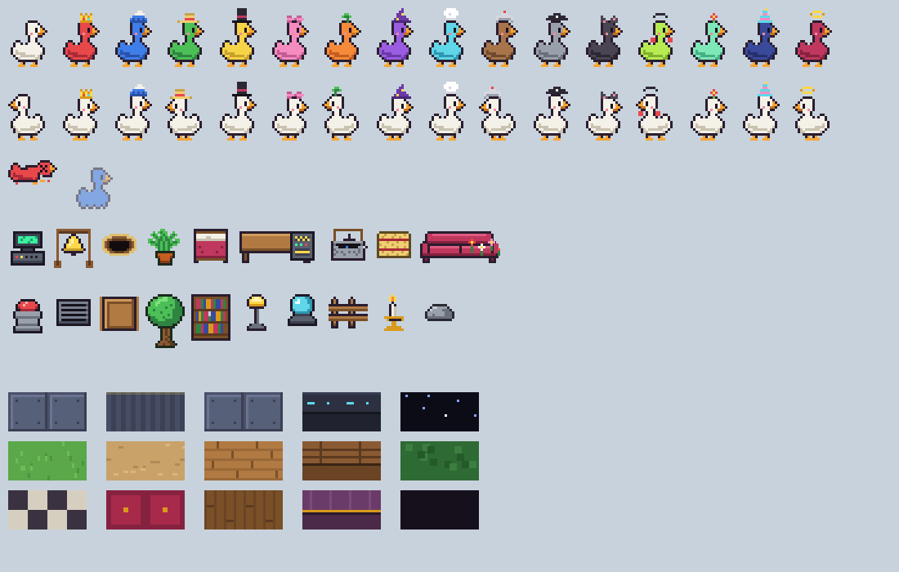
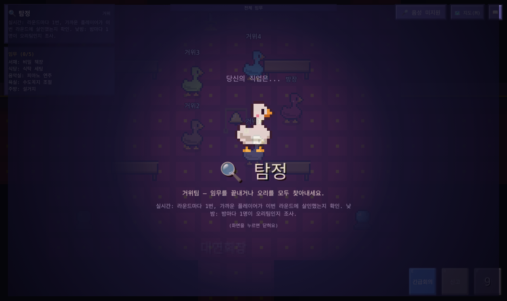
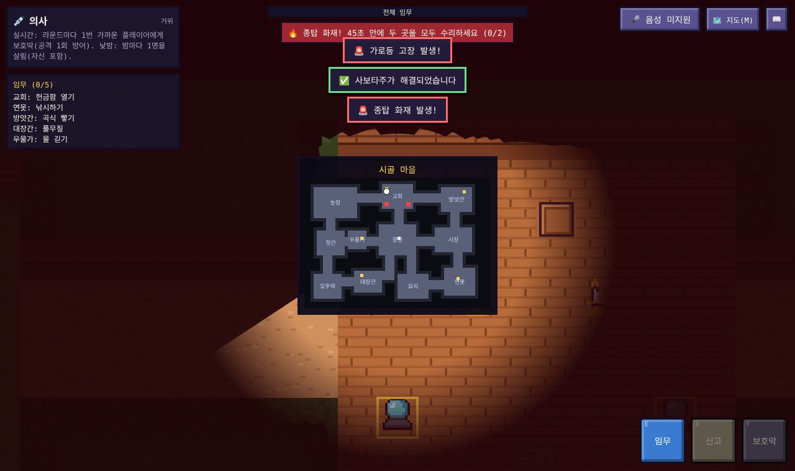
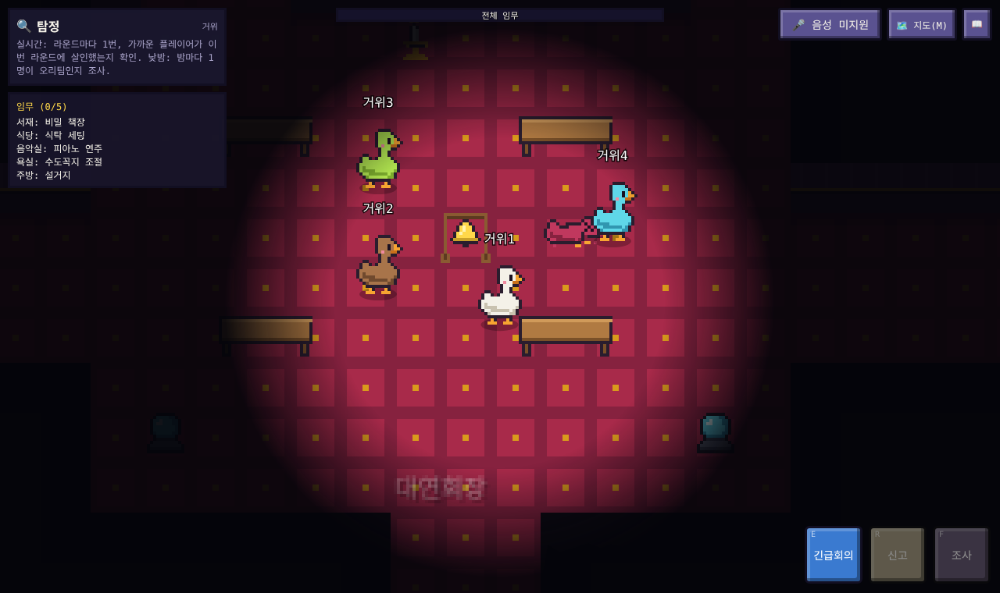
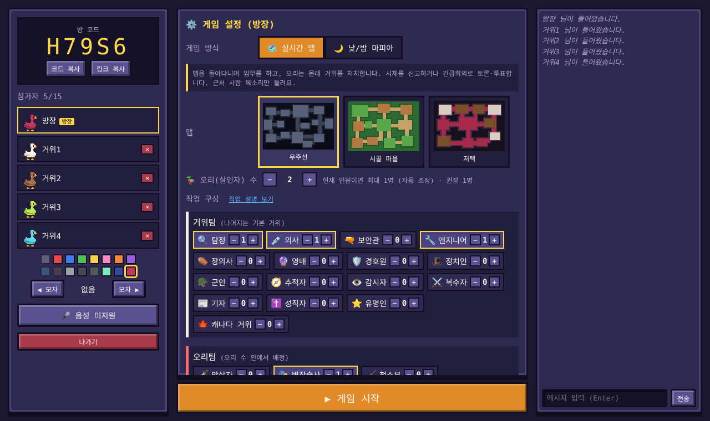
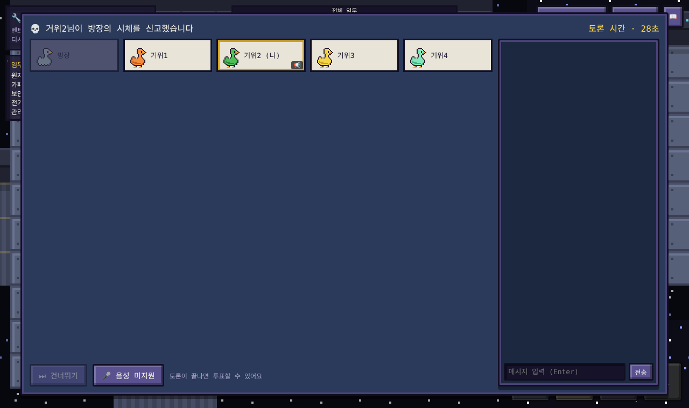
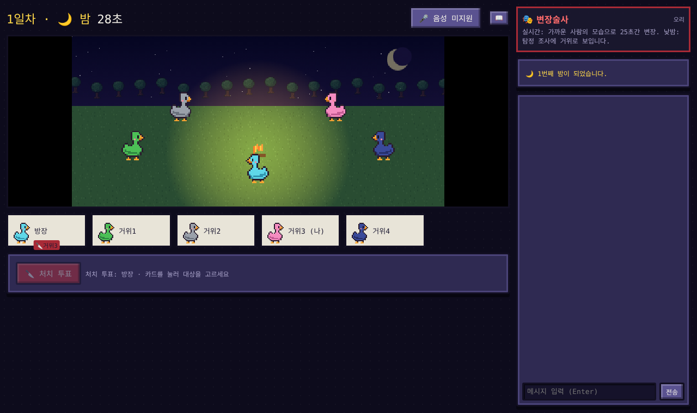

# 🪿 꽥꽥 마피아 (Quack Mafia)

거위 사이에 숨은 오리를 찾아라! **구스구스덕 · 어몽어스 · 마피아 게임**에서 영감을 받은 브라우저 소셜 추리 게임입니다.
설치 없이 브라우저에서 바로 하고, 방장이 방을 만들면 친구들이 **방 코드**로 들어옵니다. **근접 음성채팅**을 지원해요.



## 플레이하기

- GitHub Pages 주소로 접속 → 닉네임·색·모자 고르기 → **방 만들기**
- 친구에게 **방 코드(5자리)** 나 **초대 링크**를 보내면 **참가하기**로 들어옵니다 (최대 15명, 최소 3명)
- 방장이 설정을 정하고 **게임 시작**

서버가 필요 없는 P2P(WebRTC) 방식이라 정적 호스팅(GitHub Pages)만으로 동작합니다. 방장의 브라우저가 게임 서버 역할을 하므로 **방장이 나가면 게임이 끝납니다.**

## 두 가지 게임 방식 (방장이 선택)

| 🗺️ 실시간 맵 (구스구스덕/어몽어스식) | 🌙 낮/밤 마피아 (마피아 게임식) |
|---|---|
| 맵을 돌아다니며 임무 수행, 오리는 몰래 처치 | 맵 이동 없이 밤엔 능력 사용, 낮엔 토론·투표 |
| 시체 신고·긴급회의 → 토론 → 투표 | 아침에 밤사이 일이 발표됨 |
| 근접 음성 (가까운 사람만 들림) | 밤엔 오리끼리만, 낮엔 모두 대화 |
| 임무 완료 / 사보타주 / 벤트 / 시야 | 클릭으로 대상 선택 |

### 맵 3종
- **우주선** — 카페테리아, 원자로, 조종실 등 14개 방 · 사보타주: 정전 / 원자로 과열 / 통신 두절
- **시골 마을** — 광장, 교회, 농장, 연못, 묘지 등 11곳 · 사보타주: 가로등 고장 / 종탑 화재 / 게시판 훼손
- **저택** — 대연회장, 서재, 온실, 지하실 등 11개 방 · 사보타주: 두꺼비집 / 벽난로 화재 / 전화선 절단

| 우주선 | 시골 마을 | 저택 |
|---|---|---|
|  |  |  |

## 방장 설정
- 게임 방식, 맵, **오리(살인자) 수** (인원 대비 최대치 자동 조정)
- **직업 구성**: 직업마다 0~3명씩 추가
- 킬 쿨타임, 이동 속도, 거위/오리 시야, 임무 개수, 긴급회의 횟수, 토론·투표 시간, 근접 음성 거리
- 밤·낮·투표 시간 (낮/밤 모드)
- 추방 시 정체 공개, 익명 투표, 죽은 사람 직업 공개, 연인



## 직업 (31종)

### 🪿 거위팀
| 직업 | 능력 |
|---|---|
| 🪿 거위 | 기본. 임무와 토론으로 오리를 찾음 |
| 🔍 탐정 | 실시간: 대상이 이번 라운드에 살인했는지 확인 / 낮밤: 오리팀인지 조사 |
| 💉 의사 | 보호막(실시간) · 밤에 1명 치료(낮밤) |
| 🔫 보안관 | 처치 가능. 대상이 오리·매가 아니면 자신이 죽음 |
| 🔧 엔지니어 | 벤트 사용, 라운드당 1번 원격 수리 (실시간) |
| ⚰️ 장의사 | 시체(죽은 사람)의 직업 확인 |
| 🔮 영매 | 살아서도 유령의 목소리·채팅을 듣고 유령이 보임 |
| 🛡️ 경호원 | 경호 대상 대신 죽음 |
| 🎩 정치인 | 투표 2표, 첫 추방 면역 |
| 🪖 군인 | 공격 1회 버팀 |
| 🧭 추적자 | 실시간: 추적 화살표 / 낮밤: 대상이 찾아간 사람 확인 |
| 👁️ 감시자 | 실시간: 5초간 전체 위치(CCTV) / 낮밤: 대상을 찾아온 사람 확인 |
| ⚔️ 복수자 | 살해당하면 범인 이름 공개 |
| 📰 기자 | 게임당 1번, 1명의 직업을 모두에게 공개 |
| ✝️ 성직자 | 게임당 1번, 죽은 사람 부활 |
| ⭐ 유명인 | 죽으면 죽은 장소가 모두에게 알려짐 (실시간) |
| 🍁 캐나다 거위 | 살해당하면 자동 신고 (실시간) |

### 🦆 오리팀
| 직업 | 능력 |
|---|---|
| 🦆 오리 | 처치, 사보타주, 벤트 |
| 🗡️ 암살자 | 회의 중 직업을 맞추면 즉사 (틀리면 본인 사망) |
| 🎭 변장술사 | 실시간: 다른 사람 모습으로 변장 / 낮밤: 탐정에게 거위로 보임 |
| 🧹 청소부 | 실시간: 시체 치우기 / 낮밤: 오리가 죽인 사람 직업 숨김 |
| 👻 투명오리 | 8초간 투명 (실시간) |
| 🎯 저격수 | 게임당 1번 원거리 저격 |
| 🤐 침묵자 | 대상이 다음 회의(낮)에 말·채팅 불가 |
| 🕵️ 스파이 | 대상의 직업을 몰래 확인 |

### 🟣 중립
| 직업 | 승리 조건 |
|---|---|
| 🦤 도도새 | 투표로 추방당하면 단독 승리 |
| 🦅 매 | 모두 처치하고 마지막까지 생존 |
| 🕊️ 비둘기 | 살아있는 모두를 감염 |
| 🦃 독수리 | 시체를 정해진 수만큼 먹기 |
| 💰 현상금 사냥꾼 | 지정된 목표가 추방되면 승리 (목표가 다르게 죽으면 도도새가 됨) |
| 🎒 생존자 | 끝까지 살아있으면 이긴 팀과 함께 승리 |

## 조작 (실시간 모드)

| 키 | 동작 |
|---|---|
| WASD / 방향키 | 이동 (모바일은 화면 조이스틱) |
| E / Space | 임무 · 수리 · 긴급회의 |
| R | 시체 신고 |
| Q | 처치 (오리) |
| F | 직업 능력 |
| V | 벤트 |
| 1 / 2 / 3 | 사보타주 (오리) |
| M / Tab | 지도 |




## 음성채팅
- 로비나 게임 화면의 **🎤 마이크 켜기** 버튼으로 켭니다 (브라우저 마이크 권한 필요, HTTPS 필수 — GitHub Pages는 HTTPS)
- 실시간 모드: 맵에선 **가까운 사람만** 들리고(거리에 따라 작아짐), 회의 중엔 모두 들림
- 낮/밤 모드: 밤엔 오리끼리만, 낮엔 모두
- 죽으면 유령끼리만 대화 (영매는 유령 목소리를 들음), 침묵자에게 당하면 마이크가 강제로 꺼짐
- 사람 수만큼 연결되는 P2P 방식이라 8~10명 이상이면 회선에 따라 끊길 수 있어요. 회사·학교 등 일부 네트워크에선 P2P 연결이 막힐 수 있습니다.

## 개발

```bash
npm start          # http://localhost:8000 에서 실행
npm test           # 직업·승리 조건 테스트 (57개 시나리오)
```

- `?local=1`을 붙이면 같은 브라우저의 탭끼리 연결되는 로컬 테스트 모드 (음성 없음)
- 구조: `js/host.js` (방장 권한 게임 로직) · `js/rt.js` (실시간 모드 화면) · `js/turn.js` (낮/밤 모드) · `js/net.js` (PeerJS 네트워크·음성) · `js/sprites.js` (모든 도트를 코드로 직접 찍음) · `js/maps.js` (맵 3종) · `js/tasks.js` (임무 미니게임 7종)
- 외부 라이브러리: [PeerJS](https://peerjs.com/) (WebRTC 시그널링), [Galmuri](https://github.com/quiple/galmuri) 픽셀 폰트

*팬메이드 게임으로, 원작 게임들과 관련이 없습니다. 모든 그래픽은 직접 제작했습니다.*
